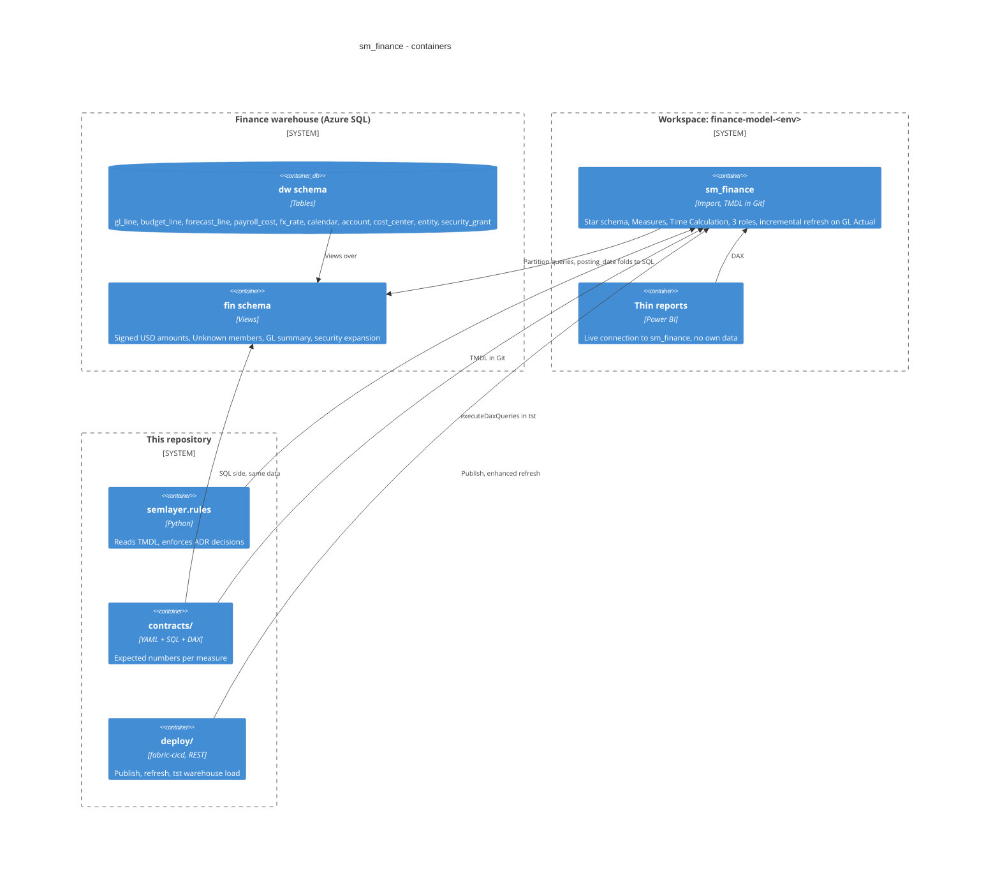
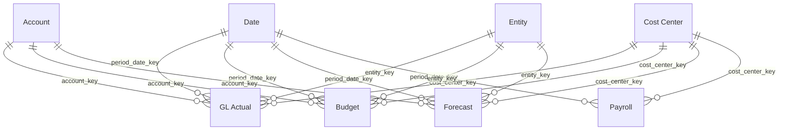

# Containers

## Model diagram

`Security Cost Center`, `Measures` and `Time Calculation` have no
relationships. All fourteen relationships are many-to-one and single direction
(rule `SINGLE_DIRECTION`).

## Release, in order

1. Pull request: ruff, sqlfluff, `python -m semlayer.check`, pytest (views on
   DuckDB, contract SQL side, rules, TMDL structure).
2. Merge to `main` starts `pipelines/release.yml`.
3. tst: apply `sql/warehouse` and `sql/views`; deploy with fabric-cicd;
   regenerate the warehouse data with the fixed seed and load it; enhanced
   refresh with the effective date pinned to the end of the data; run every
   contract (row-level security included) through executeDaxQueries and
   compare with the SQL side.
4. prd, after approval: apply `sql/views`, deploy, refresh, set the nightly
   refresh schedule. No contracts against production data.
